<p align="center">
  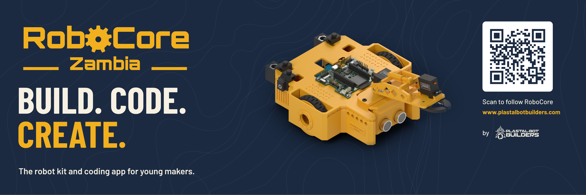
</p>

# RoboCore

RoboCore is a classroom robot kit and coding platform, designed and built in Zambia by **Plastal-Bot Builders** (Lusaka). It has four parts:
- an **ESP32-S3 controller board**;
- a **3D-printed robot** with an excavator-style arm;
- a **retail box** with a quick-start guide;
- the **RoboCore IDE**, where students code the robot with blocks or C++.

This repository holds the design sources for all of it: the PCBs, the mechanical design, the software design and the brand. Pitch decks, grant applications and community posts live elsewhere.

<table>
  <tr>
    <td width="50%"></td>
    <td width="50%">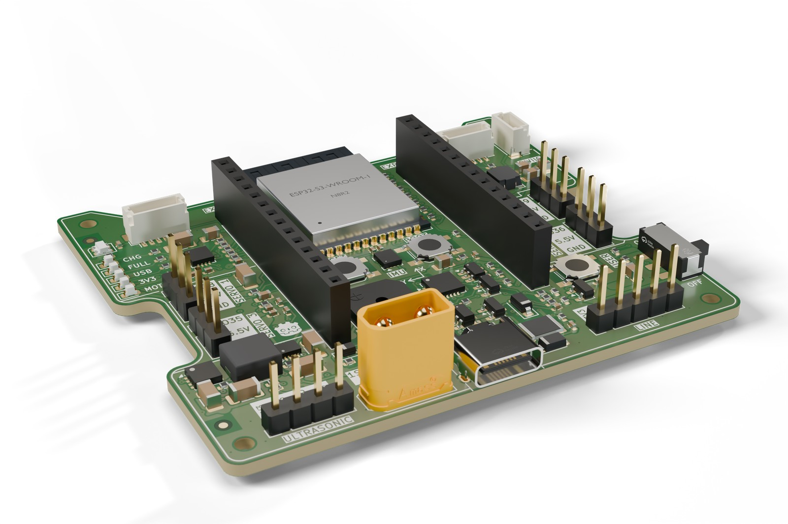</td>
  </tr>
  <tr>
    <td align="center"><b>The robot</b> (V2, Fusion 360)</td>
    <td align="center"><b>The controller board</b> (V2, KiCad 9)</td>
  </tr>
</table>

---

## The controller board (V2)

An XRP-style robot controller on a 68 × 60 mm, 4-layer board. Everything a classroom robot needs is on one board, and it charges and programs over one USB-C cable.

| | |
|---|---|
| **Brain** | ESP32-S3-WROOM-1-N8R2: dual core, Wi-Fi and Bluetooth LE, 8 MB flash, 2 MB PSRAM. Programs over native USB, so no separate programmer is needed |
| **Motors** | 2 DC motors with encoders (DRV8411A dual H-bridge, limited to 1.0 A per motor). JST SH 6-pin, matching the SparkFun XRP motors |
| **Servos** | 4 servo ports on a 5.5 V supply (TPS61089 boost, about 2.5–3 A continuous) |
| **Sensors** | Ultrasonic port (4-pin), 3-channel line-sensor port (5-pin, analog), Qwiic I2C, and an LSM6DSOX 6-axis motion sensor on board |
| **Power** | One Li-ion cell, or several in parallel (3.0–4.2 V), on an XT30 plug. Protected against a reversed or over-voltage pack. USB-C charging at 1 A (MCP73871) and a steady 3.3 V from a buck-boost converter |
| **On board** | RGB LED, buzzer, RESET, BOOT and USER buttons, charge and power LEDs, two 14-pin expansion headers |

<table>
  <tr>
    <td width="50%">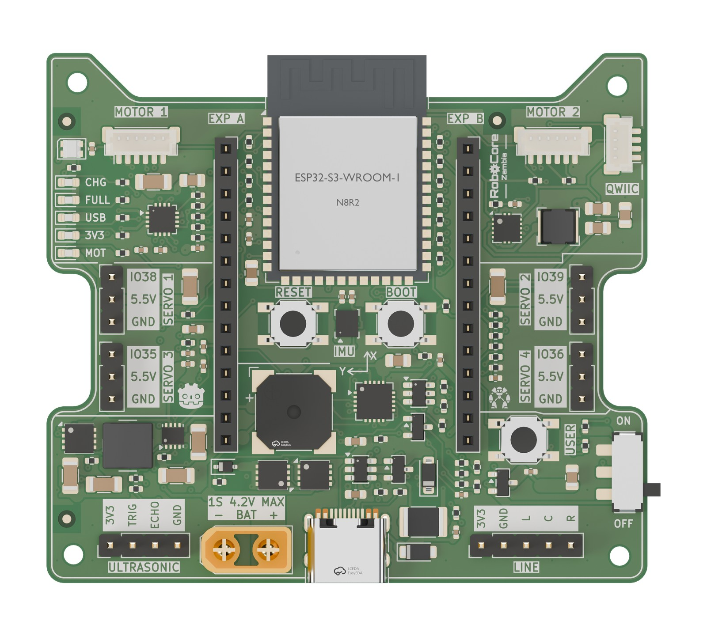</td>
    <td width="50%">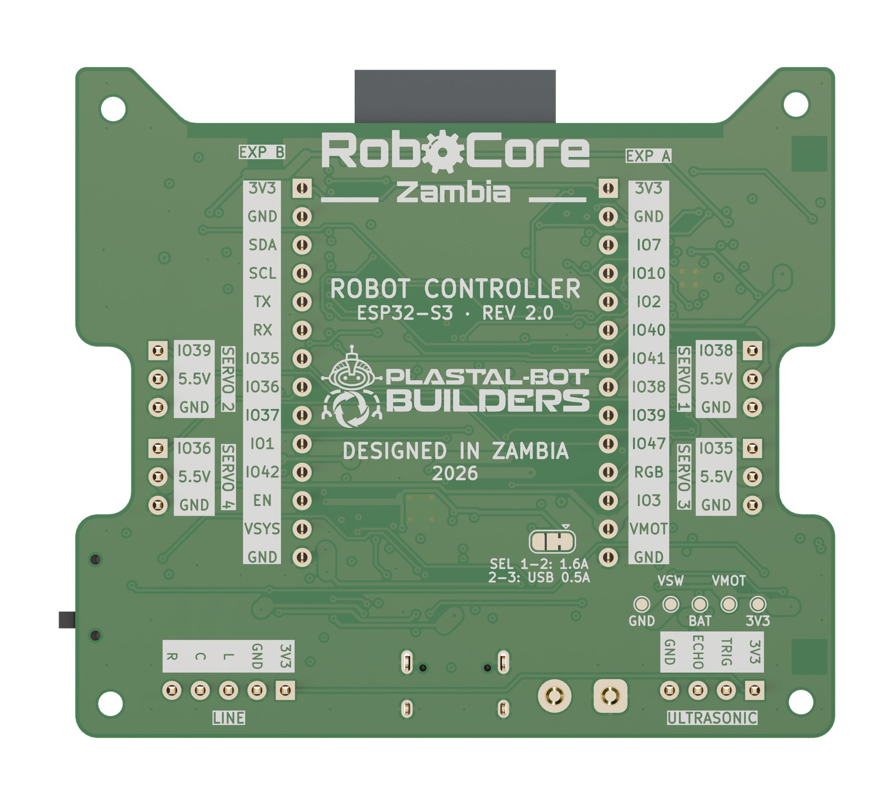</td>
  </tr>
  <tr>
    <td align="center">Top: every port labelled on the silkscreen</td>
    <td align="center">Underside: pin names and the "Designed in Zambia" artwork</td>
  </tr>
  <tr>
    <td>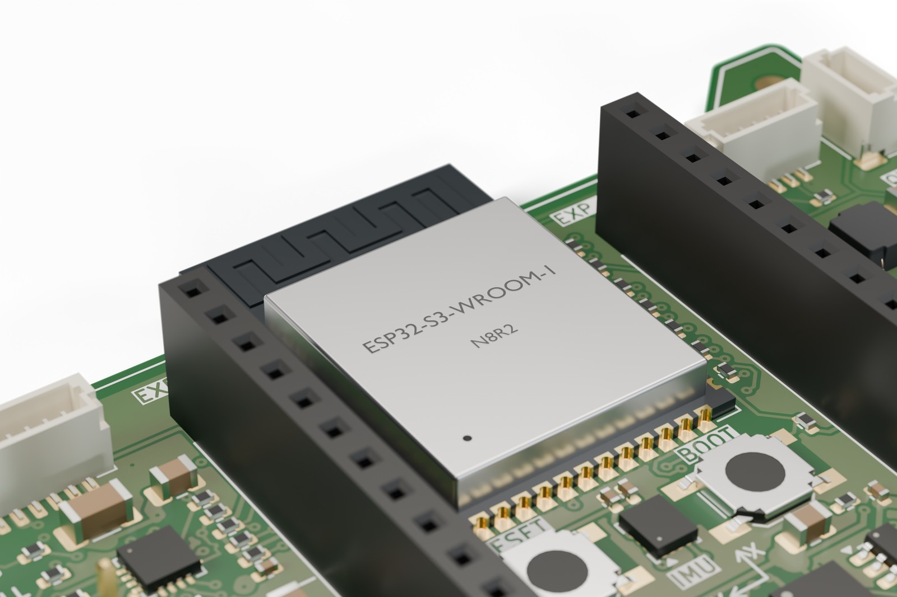</td>
    <td>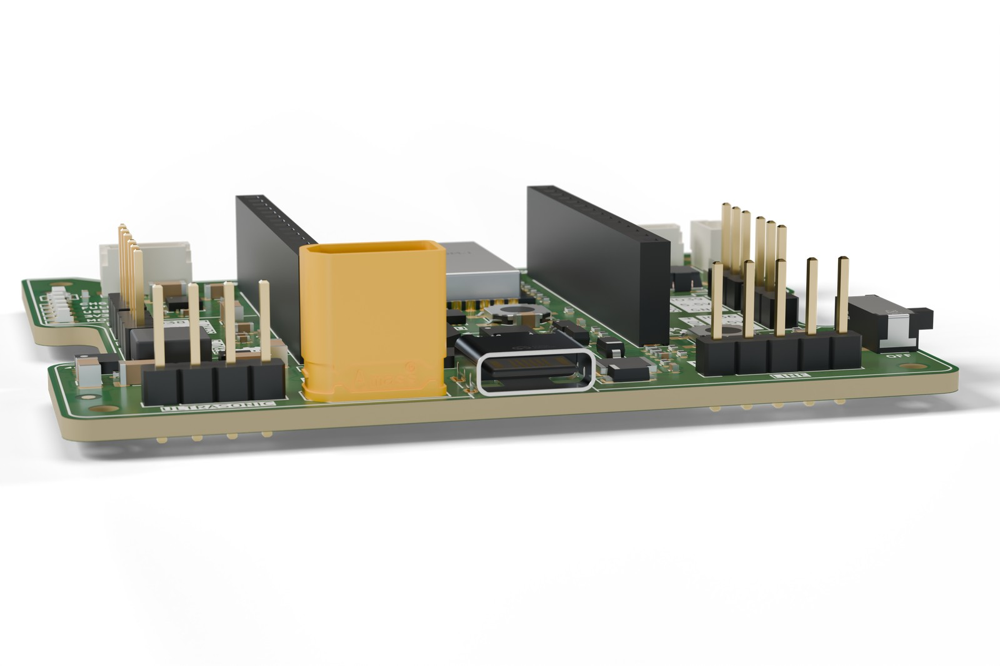</td>
  </tr>
  <tr>
    <td align="center">The ESP32-S3 module, buttons and IMU</td>
    <td align="center">The connector edge: ultrasonic, battery, USB-C, line sensor, power switch</td>
  </tr>
</table>

- **Design files:** `hardware/controller_v2/`. Open `RoboCore_V2.kicad_pro` in KiCad 9.
- **Renders:** studio renders made in Blender are in `hardware/controller_v2/renders/`, full size and 1600 px, with transparent and white backgrounds. Each shot has a map of where every part sits in the image, for pinouts and highlights in the IDE or on the website. See [its README](hardware/controller_v2/renders/README.md).
- **Before connecting anything:** the sensor headers are not keyed, so a cable can go on backwards. Read [the wrong-plug check](docs/RoboCore_V2_wrong_plug_check.md). Known issues and bring-up findings are kept in [the errata list](docs/RoboCore_V2_errata.md).
- **Sensor boards:** our own 3-channel line sensor and ultrasonic boards are designed in `hardware/sensors/`. For now the robot uses bought-in modules.

## The robot (V2)

A differential-drive robot with an XRP-style printed deck chassis, a sonar pod, and an arm module styled as a toy excavator. The arm has a shoulder servo and a gripper with geared jaws. The board sits on the deck; the battery holder slides in from the back.

<p align="center">
  
</p>

- **Model:** `mechanical/robot_v2/RoboCore_V2_Robot.f3d` (Fusion 360) and `.step` (any CAD program).
- **Generator:** the model is built by a Python generator through the Fusion API (`mechanical/robot_v2/fusion/`). [Its README](mechanical/robot_v2/README.md) explains the parameters, the fasteners and the checks: clashes, overhangs, antenna clearance and caster load.
- **Print files:** `mechanical/robot_v2/print/`, already in print orientation. Every part prints without supports on a 180 mm bed.
- **Cardboard version:** a low-cost cardboard chassis template is in `mechanical/robot_v2/cardboard/`.

## The box

<table>
  <tr>
    <td width="50%">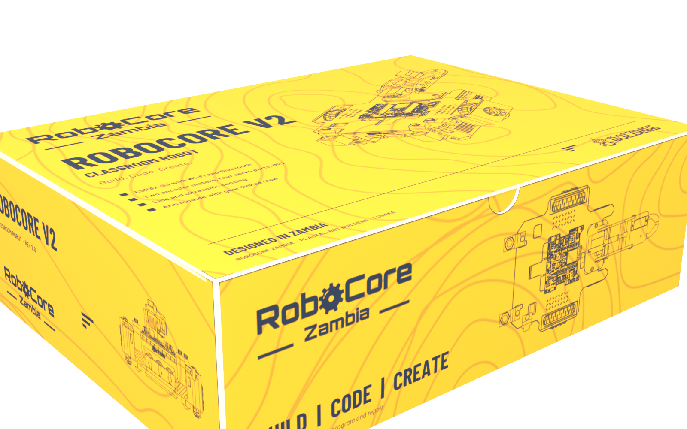</td>
    <td width="50%">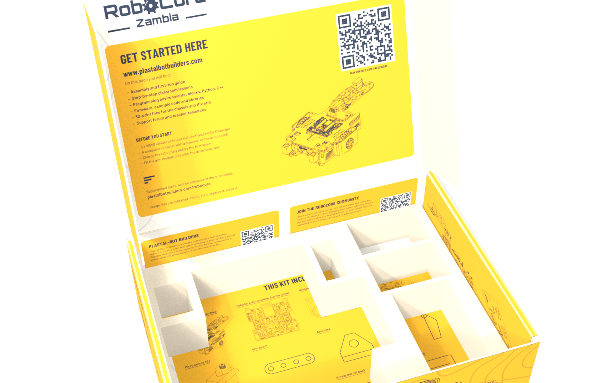</td>
  </tr>
</table>

A printed mailer box, XRP-style, with the quick-start guide printed inside the lid and a fold-up insert for the parts. The print-ready 1:1 PDFs are in `mechanical/robot_v2/packaging/`.

## Software

- **RoboCore IDE design** (`software/ide_design/`): the screens of the RoboCore IDE, built in Figma by a plugin. It covers block coding (Google Blockly) and C++ (Monaco), a hardware-first block catalogue, and a behaviour spec. The app itself is developed in its own repository, [robocore-ide](https://github.com/Plastal-Bot-Builders/robocore-ide).
- **System architecture** (`software/architecture/`): UML and C4 diagrams of the whole platform, also generated into Figma.
- **Firmware** (`software/firmware/motion/`): an arm-aware braking limiter in C, with tests.

## Brand

<table>
  <tr>
    <td width="33%">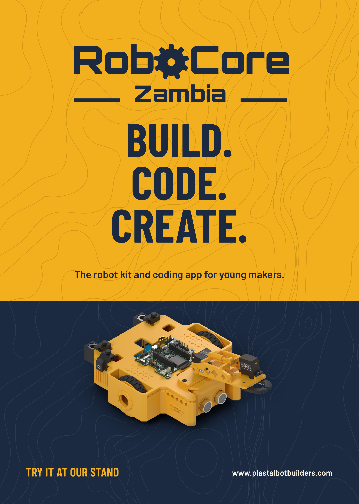</td>
    <td width="33%">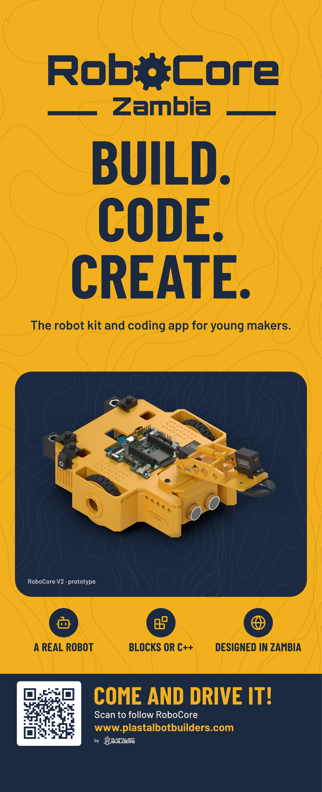</td>
    <td width="33%">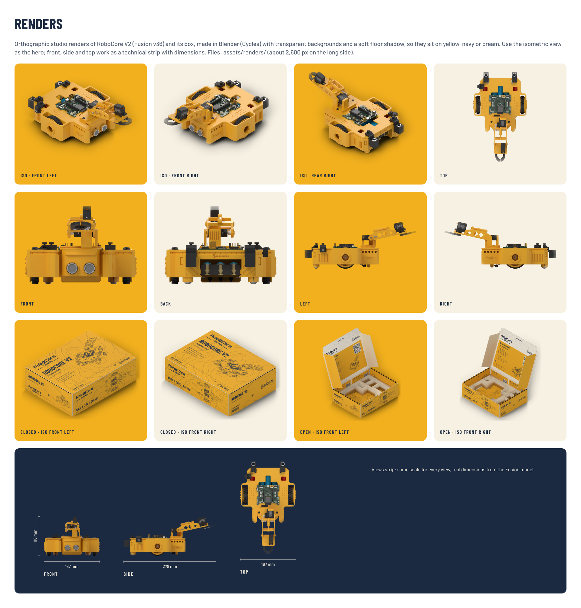</td>
  </tr>
</table>

Event branding is in `design/event_branding/`: roll-up, pop-up, banner, A5 flyer, A4 tri-fold and the brand kit, built in Figma by a plugin. The topographic backgrounds are drawn from Copperbelt elevation data.

---

## Repository layout

```
hardware/          PCB design (KiCad 9)
  controller_v2/     RoboCore V2 controller: project files, libraries (lib/), PCBWay and JLCPCB order
                     packages (fab/), generator, check, costing and Blender render scripts (tools/),
                     silkscreen artwork sources (technicalreference/), studio renders (renders/)
  sensors/           Line sensor (3-channel) and ultrasonic carrier boards for V2
  controller_v1/     RoboCore V1 (ESP32-C3) controller with its fab package and review scripts
  libraries/         Shared symbol and footprint libraries used by V1
  datasheets/        Component datasheets
mechanical/        Mechanical design
  robot_v2/          The Fusion 360 robot: model, Python generator (fusion/), print files (print/),
                     component STEP exports (export/), mailer box (packaging/), cardboard version
                     (cardboard/), vendor models (vendor/), renders
  board_step/        STEP models of the boards, for mechanical integration
  reference/         Motor and XRP reference pictures and models
  chassis_v1_spec/   Specification and script of the V1 chassis
software/          Software
  ide_design/        RoboCore IDE screens (Figma plugin), app icon, block catalogue, behaviour spec
  architecture/      UML + C4 system architecture (Figma plugin)
  firmware/motion/   Arm-aware braking limiter (C, with tests)
design/            Brand
  event_branding/    Roll-up, banner, flyer, tri-fold and brand kit (Figma plugin), topographic maps
docs/              Specification, costing and sourcing, component lists and supplier quote requests,
                   wrong-plug check and errata, schematic PDFs, part photos, A4 technical-reference
                   posters, progress renders, hand-off notes, PCBWay sponsorship request
tools/             sync_from_sources.sh: copies the working sources into this repo
```

## Opening the designs

- **PCB:** open `hardware/controller_v2/RoboCore_V2.kicad_pro` in KiCad 9. Project libraries resolve through `${KIPRJMOD}/lib`; the V1 project's symbol table points at `../libraries`.
- **Robot:** `mechanical/robot_v2/RoboCore_V2_Robot.f3d` opens in Fusion 360; the STEP beside it opens anywhere.
- **Box:** `mechanical/robot_v2/packaging/README.md`. The print files are 1:1 PDFs.
- **Board renders:** `hardware/controller_v2/tools/blender/render_board.sh` re-renders them in Blender 5.1, from the KiCad model.
- **Figma plugins:** the READMEs in `software/ide_design/`, `software/architecture/` and `design/event_branding/` explain how to load and run each plugin.

## Status (2026-10-23)

- **Controller V2:** two assembled prototypes are paid for at PCBWay (order YU1827457, 14 October) and expected to ship around 11 November. Bring-up findings will go into [the errata list](docs/RoboCore_V2_errata.md).
- **Robot:** rev 6. The model and STEP here are Fusion v33.
- **Sensor boards:** designed, not yet ordered. The robot uses bought-in modules for now.
- **IDE:** in development in [robocore-ide](https://github.com/Plastal-Bot-Builders/robocore-ide).
- **Parts:** the component list and supplier quote request for two robots are in `docs/`.

## Keeping this repo up to date

The design work happens in working folders outside this repo. Copy it in, then commit:

```bash
tools/sync_from_sources.sh           # list what changed
tools/sync_from_sources.sh --apply   # copy it in
```

The script lists every source folder it copies. On a slow connection, push large changes in several small commits.

## Licence

MIT, see `LICENSE`. Vendor models under `mechanical/robot_v2/vendor/` keep their own licences, noted in each folder's `SOURCE.txt`.
