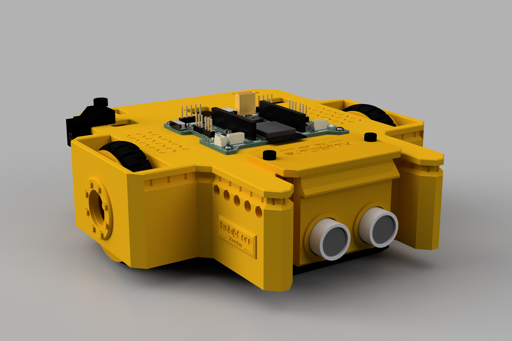
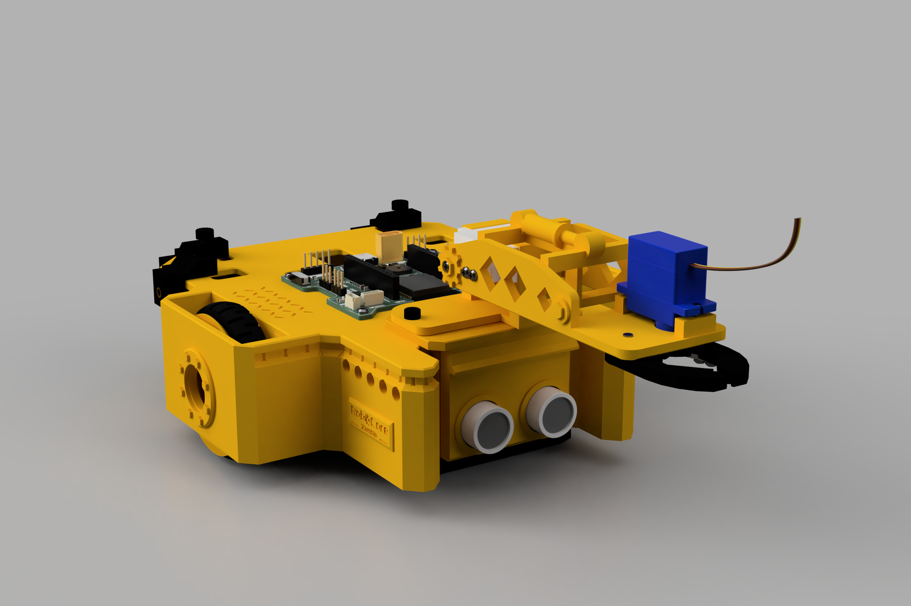
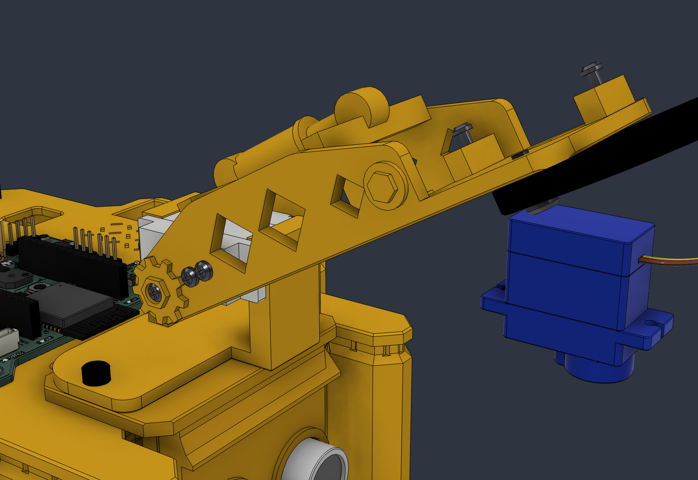
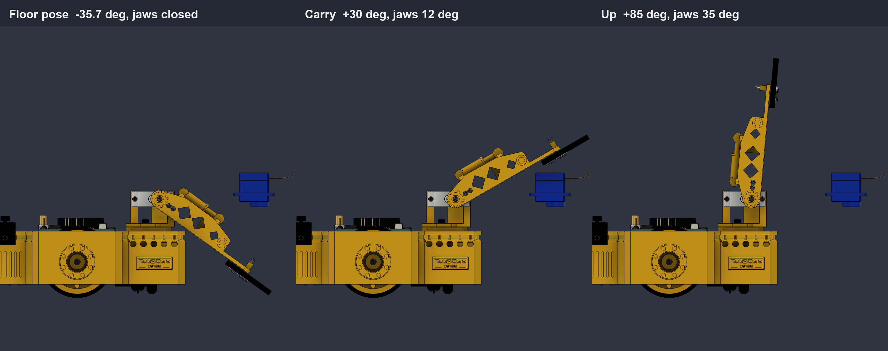

# RoboCore V2 robot (XRP-inspired): revision 5, 2026-10-07



Revision 5 follows Fred's sketches and notes of 2026-10-07:
- **Plan from the sketches:** a cross-shaped plan. It is wide at the wheels, narrower at the rear (where the motors' encoder covers sit) and narrow at the front, with a notch between two legs that guard the sonar. **Every corner is chamfered** at 45°.
- **Top covered and printed top-down, like the XRP:**
  - The chassis is a flat **deck** that covers the motors, with walls hanging under it. It is **open underneath**.
  - It **prints deck-down on the bed with no supports.**
  - The board sits **on** the deck.
- **The real motor:** the encoder cover that the Fusion motor model was missing is modelled from the maker's drawing.
- **Motors go in from below** and snap in.
- **The new battery holder** (BatteryHolder3S, 3 × 18650 **wired 1S3P**) **slides in from the back**. Two flaps snap in behind it; there is no lid.
- **Wheels:** **grippier tyres** that lock onto the rim with two beads, and a refined rim.

Second round, same day, after the toy excavator photo:
- **An arm with character.** The arm module is now styled as an excavator:
  - a curved boom with diamond truss windows;
  - a hydraulic cylinder along the top;
  - the RoboCore gear and a hex bolt head on the shoulder, and bolt-head bosses at the wrist;
  - claw jaws with bucket teeth;
  - a cab-style base with louvre vents;
  - excavator yellow with black jaws.
- **Joints, so you can move the model in Fusion:** shoulder, the two gear-linked jaws, both wheels, the battery sliding out of the back, and the line-sensor sled dropping out.
- **Every screw, insert, washer, nut and servo horn** is modelled and in place.
- **Fred's own chassis edits are kept:**
  - the side windows are filled;
  - a Ø16 hole in each wheel-section side reaches the wheel screw;
  - a 2 mm fill closes the gap at the front of each wheel well.

  They are now in the generator too (`SIDE_WINDOWS`, `WHEEL_ACCESS_D`, `WELL_CORNER_FILL`).

Third round, same day, after Fred's earth-mover photos (a CAT 797F haul truck, a JCB backhoe, loaders and dozers):
- **The chassis now has the same character as the arm**, without changing its structure.
- It gains wheel hubs, fender arches, engine louvres, hazard chevrons, tail lights, RoboCore badges and tread-plate walkways.
- There is a new **construction** colour scheme: all yellow with black details, like a CAT machine.

Fourth round, same day, after Fred's side-profile notes:
- **The rail lip is gone.** The outer wall now runs straight up into the deck, so the side reads as one continuous body. The expansion bus is a flush **groove** under the deck instead; the clips hook a tongue into it.
- **New sonar mount:** a headlight-style **pod** on the dock plate. The board snaps in from the back; no more sliding it down grooves.

Fifth round (2026-10-08/09), Fred's off-the-shelf parts:
- **Ultrasonic:** the custom RoboCore_Ultrasonic is replaced by the **HC-SR04** model Fred added (45 × 20 mm, Ø16 cans 26 mm apart, 4-pin right-angle header). It is mounted **header up**, so its Dupont plugs sit inside the pod under the plate.
- **Servos:** the built SG90 reference bodies are replaced by Fred's models: the **MG90S** assembly on the shoulder and the **SG90** (with cable) on the gripper. The arm base, posts, horns and screws fit both without change (the real cases match the design frame within 0.3 mm).
- **Line sensor:** still the RoboCore_LineSensor. The Faduino IR board Fred mentioned is not in the project folder yet; when it is, the sled stays (same board size) and only the deck's plug slot moves (see open items).

Rev 1–4 are archived in `fusion/rev1…4/`, `renders/rev1…4/` and `print/rev2…4/`.








| | |
|---|---|
| Before / after | `renders/before_after_profile.png` (lip and slide-in bracket vs flush groove and sonar pod); the earlier rounds' comparisons are in `renders/rev5/` (rev 4 vs rev 5, the arm styling, the earth-mover details) |
| Sonar pod | `renders/sonar_pod.png`, `sonar_pod_rear.png`; bus clip in the groove: `renders/bus_clip.png` |
| Chassis details | `renders/chassis_wheel_side.png` (hub, fender, louvres, badge), `chassis_rear.png` (chevrons, tail light), `chassis_deck.png` (tread plate) |
| Arm | `renders/arm_closeup.png`, `arm_closeup_left.png`, `arm_gripper_under.png` (horn and screws under the gripper), `arm_poses.png` (floor / carry / up) |
| Colour schemes | `renders/schemes/colour_schemes.png` (teal, orange, construction yellow). The renders and heroes are in construction yellow |
| Views | `renders/robot_{iso, iso_front, iso_rear, side, top, under_iso}.png` (arm raised), `renders/robot_noarm_*.png` (no arm), `renders/robot_arm_floor_*.png` (arm lowered), ray-traced `renders/robot_hero.png` and `robot_hero_noarm.png` |
| Expansion bus | [`EXPANSION_BUS.md`](EXPANSION_BUS.md) and `renders/bus_spec.png` |

## Files
| What | Where |
|---|---|
| Fusion 360 design (cloud) | **RoboCore V2 Robot** in UniPod Project → RoboCore V2. Rev 5 is the latest version. The main board, line sensor, ultrasonic and **BatteryHolder3S** are linked from their own files |
| Offline copy | `RoboCore_V2_Robot.f3d` (8 MB) and `RoboCore_V2_Robot.step` (whole robot with the boards, 28 MB) |
| Print files | `print/RoboCore_V2_<part>.stl` / `.3mf`. **Every file is already in its print orientation** (the chassis lies on its deck). The line sled comes in three heights: `Line_sled_9.5/10.5/11.5` |
| Generator | `fusion/build_robot.py`, with every dimension in `fusion/rc_params.py`. Also `rc_lib.py`, `checks.py`, `export.py`, `view.py`, and `bus_drawing.py` (bus drawing, runs outside Fusion) |

## What changed (rev 4 → rev 5), point by point against Fred's notes
1. **Profile from the sketches, chamfered corners:**
   - Three sections:
     - the **wheel section** is 162 mm wide over the walls (y −35…35);
     - the **rear section** is 127 mm wide and holds the encoder covers;
     - the **front section** is 94 mm wide, ending in two legs either side of a 66 mm notch for the sonar.
   - The chamfers are 10 mm at the rear corners, 5 mm at the leg tips and wheel corners, and 5 mm / 4 mm at the inside corners. The wheel corners are small so the chamfer clears the tyres.
   - Size: **162 × 166 mm** over the walls (168 × 172 in the earlier rev 5 drafts, which had a 3 mm rail lip), 52 mm to the deck top.
2. **Real motor dimensions:**
   - The STEP model lacked the encoder cover. It is now a reference part built from the drawing:
     - 25.8 (thickness) × 25.2 (height) × 22.3 (length) mm, behind the gearbox;
     - plus the 19.2 mm end boss and the socket.
   - The motors sit 1.5 mm further out than in the first rev 5 draft. This makes room for a 1.6 mm rail wall between the battery and each cover, with 0.6 mm clearance.
3. **Motors from below:**
   - The shaft slot, the pin slot and the boss groove in the shaft wall are open at the bottom.
   - The motor (wheel on) goes straight up until its gearbox top meets the **stops** under the deck.
   - **Two hooks** on the inner wall then spring in under the gearbox's bottom edge. They have a 45° lead-in, so the motor pushes them aside on the way up.
   - The wheel load pushes the motor up into the stops, not onto the hooks.
4. **The new battery, from the back, with a snap fit (no lid):**
   - The BatteryHolder3S slides in through the opening in the rear wall. Its two bottom edges ride on **45° V-rails** that run its full length; they also centre it.
   - It slides in until it meets the **front stops**.
   - The rear ends of the two rail walls are **snap flaps**. They hang from the deck only, so they flex outward. Each has a bump with a 45° ramp that springs in behind the holder's rear corners (1.5 mm catch).
   - **To remove it:** push both flaps outward (just inside the corners of the rear opening) and slide the holder out.
   - Nothing in its path has a flat ledge, so all of it prints top-down.
5. **Covered top, printed top-down like the XRP:**
   - The deck covers the motors, encoders, battery and nose.
   - A window under the board clears its pin-header legs and lets cables through.
   - Openings cut through the deck:
     - the wheel wells;
     - a slot behind the board (battery lead to the XT30, plus relief for the USB-C plug);
     - a slot in front of the board (sensor cables);
     - a slot over each encoder socket;
     - a cable port in each rear corner.
   - Inside, everything hangs from the deck:
     - walls;
     - motor stops;
     - latch tongues;
     - the nose ceiling over the line-sensor pocket, carried by two cross walls and a middle rib (longest bridge about 18 mm).
6. **Board on the deck:**
   - The board sits flat on the deck (z 52, 6 mm higher than before), held by 4 × M2 into heat-set inserts in bosses under the deck. This is the XRP layout.
   - Its IMU is still right above the axle.
   - The battery is underneath, as asked.
7. **Twin rear ball casters, printed in:**
   - The floor that held the bayonet caster is gone. Instead, a **½" ball snaps up into a socket in each rear corner**: the lip is 0.7 mm smaller than the ball and has 4 slits.
   - A Ø4 vent through the deck lets you push a ball out with a pin.
   - The separate caster part is gone.
8. **Wheels:**
   - **Tyre:** grippier, with a rounded crown and a staggered block tread (2 × 24 grooves). It is stretched onto the 46 mm seat (ID 45.2), and **two beads lock into 45° grooves** in the rim, so it can't walk off.
   - **Rim:** the old centre bead is gone.
9. **Expansion bus, adapted to the deck:**
   - **Clips clamp onto the deck:** the tab lies on the deck and a thumb screw presses down, pulling the clip's tongue up in the bus groove.
   - Detents run in the groove on every straight run and outside chamfer except the wheel sides (**54**).
   - The Technic hole row stays only where there is room behind the wall: the front-section sides, **10 holes**.
   - See [`EXPANSION_BUS.md`](EXPANSION_BUS.md).
10. **Arm ballast:** two **ballast clips** on the rear wall at x ±44, each holding 3 × M8 nuts, replace rev 4's internal rack.
11. **Kept from rev 4:**
    - the sonar on a bracket on the front dock (now the pod, see below);
    - the snap-in line-sensor sled;
    - the 2-servo arm on the bracket;
    - the RoboCore logo on the bracket and the Plastal-Bot logo on the rear wall.

## The chassis, styled after the earth movers
| On the earth movers | On the RoboCore chassis |
|---|---|
| Huge wheel hubs (final drives) with rings of bolts | A raised hub ring (Ø28) round each wheel-screw access hole, with 8 hex bolt heads |
| Fenders over the wheels | A raised fender arch over each wheel on the wheel-section sides |
| Engine-bay louvres (JCB, CAT) | 7 louvre slots on each rear-section side, over the encoder covers |
| Black/yellow hazard chevrons on the rear | 45° chevron grooves either side of the battery opening (3.2 mm stripes, so they are easy to paint black) |
| Tail lights | A recessed light with a raised lens on each rear chamfer (paint it red) |
| Brand plate ("CATERPILLAR", "JCB") | A raised badge with the RoboCore logo on each front-section side |
| Anti-slip tread plate on the walkways | Diagonal tread grooves in the deck over each gearbox |
| Yellow with black details | The **construction** colour scheme: chassis, wheels, bracket and arm in yellow; tyres, jaws and clips black |

- **Shallow relief only:**
  - the raised parts stand 1–2.5 mm proud;
  - the grooves are 0.6–1.2 mm deep.

  So the outline (168 × 172 mm), the clearances, the joints and the top-down print are unchanged.
- **Mass:** the chassis gains 2 g, to 136 g.
- **Fusion:** these are the `chassis_style` and `chassis_tread` steps. They were added on top of the current chassis, so Fred's own edits are still there.

## Side profile: one body, flush bus groove (fourth round)
Fred found the 3 mm rail lip made the body look stepped and bulky. It is gone:
- The outer wall runs straight up into the deck on every face. The only line on the side is the bus groove.
- **The bus groove** is 1.8 mm deep, z 46–49, just under the deck, with a 45° underside so the chassis still prints top-down with no supports. A 1.5 mm band inside the wall backs it up (4.5 mm of wall there).
- No groove over the wheel sections: the wall there is only the wheel-well skin, and that is where the hubs and fenders are.
- The bus and ballast clips now have a **tongue** that goes into the groove instead of a hook over a lip; the thumb-screw-on-the-deck clamp is unchanged. The rail coupon test piece follows.
- The robot is 6 mm narrower and shorter over all: **162 × 166 mm**.

See [`EXPANSION_BUS.md`](EXPANSION_BUS.md).

## Sonar pod (fourth round)
Fred found the slide-in bracket impractical and wanted a more modern look. The new mount:
- The **plate on the dock stays** (2 × M3; the arm base stacks on it), now with chamfered corners to match the chassis.
- A **headlight-style pod** hangs from the plate's front: a 2.5 mm faceplate with two round eyes and raised bezels, a 47° brow over them, 2 mm walls each side and chamfered front corners. The cans stand 9 mm proud of the faceplate, like a loader's lights.
- **Fitting the board:** push it into the pod **from the back**, cans first, header up. The cans drop into the eyes (Ø16.8 for the Ø16 cans), which locates the board, and two **snap strips** on the side walls click in behind the PCB. To release, push the strips outward with a fingernail and draw the board back.
- **Cable:** four Dupont jumper wires onto the header, led back through the 16 × 13 mm slot in the nose wall and up through the front cable slot to J403.
- A small window at the bottom of the faceplate clears the HC-SR04's crystal, which stands 3 mm proud of the board's front face.
- The JST plug on the back of the board goes straight back through the slot in the chassis nose, as before.
- The board sits **flat** (no tilt), its cans centred **24 mm** above the floor (it dropped 6 mm so the header plugs clear the plate). With the HC-SR04's 15° measuring angle the floor stays outside the beam beyond about 90 mm.
- The pod sits between the two front legs with 7.7 mm each side, and the cans end 2 mm behind the legs' tips, so the legs still guard them.

## The arm module, styled after the toy excavator
| Toy excavator | On the RoboCore arm |
|---|---|
| Curved boom with an open frame | Each side plate has a curved boom outline (up to 12.5 mm high in the middle) with three diamond truss windows. They are 45° diamonds, so they print without supports and echo the chassis |
| Hydraulic cylinder along the boom | A barrel, gland, rod and two eyes run along the top between the plates. Two saddles and a central web carry it, and that stiffens the yoke too |
| Big round pivot bosses with bolt heads | The RoboCore 9-tooth gear with a hex bolt head on the right shoulder (the horn screw sits in a counterbore in it), and hex bolt-head bosses at the wrist on both plates |
| Bucket with teeth | The jaws are claws, with a curved back and three bucket teeth on each grip edge (they also grip better) |
| Cab with louvre vents | The arm base's rear post has five louvre slots, and the base plate has a rounded "counterweight" back |
| Yellow and black | Colour scheme: the arm and base in excavator yellow, the jaws black (print the arm in yellow PETG) |

The mechanism and its numbers are unchanged:
- shoulder axis at y 64, z 77;
- floor pose −35.7°;
- gripper on gear sectors.

The arm is 3 g heavier, at 11 g.

## Moving the model in Fusion (joints)
Open **RoboCore V2 Robot** and drag a part, or right-click a joint in the browser and choose **Drive Joints**:

| Joint | What moves | Range |
|---|---|---|
| Shoulder | the arm with the gripper servo, horn and screws | −35.7° (jaws 2 mm off the floor) … +85° |
| Jaw L / Jaw R | the jaws; the **Gripper gears** motion link makes them open together, like their gears | 0° (closed) … 35° each |
| Wheel L / Wheel R | each wheel with its tyre, screw and washer | free |
| Battery | the BatteryHolder3S sliding out of the back | 0 … 110 mm |
| Line sled | the sled and the line sensor dropping out of the bottom | 0 … 40 mm |

- Everything else is grounded.
- Screws, horns and the gripper servo ride along with their parts in rigid groups.
- From a script:
  ```python
  build_robot.pose(arm_deg, jaw_deg, battery_out_mm, sled_down_mm, wheel_deg)
  ```

There were no clashes in three poses: floor with the jaws closed, carry (+30°, jaws 12°) and up (+85°, jaws 35°), screws included.

## Hardware (modelled and placed)
| Qty | Part | Where |
|---|---|---|
| 4 + 4 | M2 heat-set insert (Ø3.2 hole) + M2 × 6 pan head | board on the deck |
| 2 | M2 × 6 pan head (self-tapping) + M2 washer | wheels, into the shaft's centre hole (reach it through the Ø16 hole in the side wall) |
| 2 | M3 heat-set insert | dock towers |
| 2 | M3 × 8 socket head (no arm) **or** M3 × 10 socket head (with the arm base stacked on the bracket) | sonar bracket (+ arm base) into the dock |
| 4 | M2 × 8 pan head (self-tapping, come with the servos) | servo tabs, 2 per servo |
| 2 | SG90 single-arm horn (come with the servos) | shoulder (against the right boom plate), gripper (in a slot under the driven jaw) |
| 1 | M2 × 8 pan head | shoulder horn centre screw, in the counterbore of the gear boss |
| 2 | M2 × 5 pan head | through the right boom plate into the shoulder horn's arm |
| 3 | M2 × 4 pan head | gripper horn: centre screw + 2 through the horn arm into the jaw |
| 1 | M3 × 8 pan head (self-taps into the deck) | idle jaw pivot |
| 3 + 3 | M3 heat-set insert + M3 × 8 thumb screw | bus clip and the two ballast clips (the screw presses on the deck) |
| 1 | M3 heat-set insert | bus clip accessory boss |
| 6 | M8 hex nut | ballast clips, 3 each |

## Checks (rev 5, run with `fusion/checks.py`, last run 2026-10-07)
| Check | Result |
|---|---|
| Interference: each part against its neighbours, boards, motors and every screw included | **0 clashes** in the carry, floor and up poses, except a 0.08 mm³ graze between the right snap hook and the HC-SR04's edge (the next pod rebuild widens the pod 0.2 mm). Allowed on purpose: the tyre's stretch fit, and screws that self-tap into a smaller pilot or thread into the servo spline. Fusion cannot analyse the linked servo assemblies against the parts round them, so those pairs are checked by eye |
| Antenna (metal within 15 mm of the ESP32 antenna end) | Closest metal: the front board screws at **19.6 mm** (now the real screws and inserts). Then shoulder servo 20.8, dock screws 25.5, battery holder 26.5, ultrasonic 41.2 mm. **Pass** |
| CG / casters / tipping, glass balls, no arm | 457 g, CG (0.2, −10.6, 29.4) mm. The **two casters carry 14 %**. Tips forward only above 0.36 g of braking, sideways above 2.3 g |
| Same, ½" steel balls | 471 g, casters 16 % |
| **Arm fitted + 6 × M8 in the ballast clips** | 542 g (the MG90S is 4 g heavier than an SG90), CG (−0.1, −7.3, 35.0). **Casters 10 %** (steel: 12 %). Tips forward above 0.21 g |
| Arm fitted, no nuts | 515 g, casters **4 %**. Tips forward above 0.08 g. **Fit the nuts** |
| Line sensor | Underside 10.5 mm (allowed 9–13). TCRT5000 faces 3.4 mm off the floor. The skid touches first on a nose-dive (2.9° vs 3.7°) |
| Bed fit (A1 mini, 180 mm cube) | Every part fits. The largest is the chassis: **167.2 × 166.0 × 48.3 mm** over the hubs, lying on its deck |
| Overhangs in print orientation (chassis top-down) | **No unsupported overhangs in any part.** The only flat ceilings are short bridges (nose ceiling about 18 mm; the 2 mm motor-hook catches) |

## Printed parts (masses from the shell/infill model in checks.py)
| Part | Qty | Material / colour (A) | Print orientation (as exported) | Mass |
|---|---|---|---|---|
| Chassis | 1 | PETG yellow (construction) or teal | **deck (top) down** | 133 g |
| Line sled (10.5; 9.5 / 11.5 to taste) | 1 | PETG black | upside down | 3.6 g |
| Wheel | 2 | PETG dark teal | flat inner face down | 7.9 g each |
| Tyre | 2 | TPU 95A black | flat | 4.6 g each |
| Sonar bracket (pod) | 1 | PETG yellow | plate top face down (pod up) | 9.0 g |
| **Base robot** | | | | **170 g** |
| Arm base / Arm / Jaw L / Jaw R | 1 each | PETG **yellow** / black jaws | as exported (arm deck down, cylinder up) | 7.9 / 11.1 / 1.1 / 1.3 g |
| Ballast clip | 2 (with the arm) | PETG black | on its side | 3.8 g each |
| Bus clip (template) | as many as you like | PETG black | on its side | 1.7 g |
| Rail coupon (test piece) | 1 | PETG | deck down | 3.3 g |

Print settings:
- 0.2 mm layers, 3 walls, 25 % gyroid (wheels and arm 30 %, jaws and clips 40 %).
- **No supports.** Turn on bridge detection; the slicer's defaults are fine for the 18 mm nose ceiling.
- PETG at 240–250 °C; TPU slow (≤ 25 mm/s).
- The chassis's deck is a big flat area on the bed (about 150 cm²). Use a clean textured PEI sheet and a 5 mm brim if the corners lift.
- The tread-plate grooves are in the face that lies on the bed (1 mm wide, 0.6 mm deep). If your first layer squashes them shut, turn on elephant-foot compensation (about 0.15 mm).
- For the earth-mover look, paint the chevron grooves black and the tail-light lenses red, or use a marker.

The chassis is roughly 9–11 h on an A1 mini at standard PETG speeds (an estimate; slice to confirm). **Print the rail coupon and one bus clip first** (about 30 min) to check your printer's tolerances.

## Bill of materials (per robot)
| Qty | Part | Where |
|---|---|---|
| 2 | XRP-style TT gearmotor with encoder (SK51D 90:1, 6-pin) + its cable to the board's MOTOR sockets | motors |
| 1 each | RoboCore V2 board, RoboCore Line Sensor | |
| 1 | **HC-SR04** ultrasonic module (the common 45 × 20 mm board) | sonar pod |
| 1 | **BatteryHolder3S** (3 × 18650, 61.6 × 78.4 mm), **wired 1S3P (all three cells in parallel)**, with an XT30 female lead to the board | battery |
| 3 | 18650 cells, matched (same type, charged to the same voltage before fitting) | |
| 2 | **½" (12.7 mm) steel balls** (bearing balls or slingshot ammo, 8.4 g) or 12.7 mm glass marbles | rear casters |
| 4 | Dupont jumper wires, female-female, 200 mm (or a JST SH 4-pin to Dupont lead) | HC-SR04 header → J403 |
| 1 | JST SH 5-pin cable, 200 mm, straight-through | line sensor → J404 |
| 4 | M2 heat-set insert (Ø3.2 hole) + 4 × M2 × 6 | board on the deck |
| 2 | M3 heat-set insert, short (Ø4.0 hole) | dock towers |
| 2 | M2 × 6 self-tapping + M2 washer | wheels to shaft centre holes |
| 2 | M3 × 8 socket head | sonar bracket into the dock (M3 × 10 when the arm base stacks on it) |
| **Arm module** | | |
| 1 + 1 | **MG90S** (shoulder, metal gears) + **SG90** (gripper) micro servos | screws and horns come with the servos |
| 1 | M3 × 8 pan head (self-taps into the deck) | idle jaw pivot |
| 2 | M3 × 10 socket head | arm base + sonar bracket into the dock (instead of the 2 × M3 × 8) |
| 1 + 2 + 3 | M2 × 8 pan head + 2 × M2 × 5 + 3 × M2 × 4 | shoulder horn centre screw, shoulder horn arm to the boom plate, gripper horn (the servos' own screws are too short for the shoulder) |
| 2 | Ballast clips (printed) + 2 × M3 insert + 2 × M3 × 8 thumb screw | rear rail |
| 6 | M8 hex nut (about 5.2 g each) | 3 in each ballast clip |
| **Each bus clip** | | |
| 2 | M3 heat-set insert + 1 × M3 × 8 thumb screw | clamp (screw onto the deck) + accessory mount |

The base robot needs **8 screws and 6 inserts**. There is no battery screw any more.

## Assembly
1. **Inserts:** 4 × M2 into the deck at the board holes, 2 × M3 into the tops of the dock towers.
2. **Wheels onto motors:**
   - Stretch each tyre over its rim until both beads drop into the rim grooves.
   - Push each wheel onto its shaft and fit an M2 × 6 + washer.
3. **Casters:** with the chassis upside down, press a ½" ball up into each rear socket until the lip clicks over it.
4. **Motors (chassis upside down, battery out):**
   - Plug the encoder cable into the motor first.
     - On the **left** motor the socket faces down. Its cable comes out under the robot and goes up through the **rear-left cable port**.
     - On the right motor the socket faces up, under the **plug slot** in the deck.
   - Push each motor + wheel straight in: shaft outward, encoder cover to the back. The shaft and pin slide up their slots and the wheel goes into its well. Keep pushing until the gearbox meets the stops and **both hooks click** under it.
5. **Line sensor:**
   - Slide the board into the sled grooves from the open rear end: TCRT5000s down, JST socket toward the right.
   - Push the sled up into the nose pocket until both bumps click.
   - Plug in the 5-pin cable and lead it up through the **front cable slot**.
6. **Ultrasonic:**
   - Plug the 4-pin cable into the board's socket.
   - Push the HC-SR04 into the pod from the back, cans first, header pins up, until both snap strips click behind it.
   - Feed the plug and cable through the slot in the front wall, then bolt the bracket to the dock (2 × M3 × 8; M3 × 10 if the arm is going on).
   - Lead the cable up through the front cable slot.
7. **Board:** set it on the deck and screw it down with 4 × M2 × 6. Plug in the motors, then the sensors.
8. **Battery:**
   - Fit the three cells all the same way round; the holder is wired 1S3P.
   - Slide the holder in from the back, onto the V-rails, until it meets the front stops and **both flaps click** behind it.
   - Bring the XT30 lead up through the slot behind the board.
   - **To remove it:** push the two flaps outward and slide the holder out.
9. **Arm module (optional):**
   1. Fit the MG90S between the base posts (2 × M2 × 8 tab screws).
   2. Push a horn onto the shoulder spline so the arm will sit at **−35.7° (floor) at servo 0°**.
   3. Put the boom's left plate over the D-pin and its right plate against the horn:
      - the M2 × 8 centre screw goes in through the gear boss;
      - 2 × M2 × 5 go through the plate into the horn's arm.
   4. Fit the SG90 on the deck posts (2 × M2 × 8).
   5. Put the second horn into the slot under the driven jaw (2 × M2 × 4). Close the jaws, push the jaw onto the spline and fit the M2 × 4 centre screw from below.
   6. Hang the idle jaw on its M3 × 8.
   7. Set the base on the sonar bracket and bolt both to the dock (2 × M3 × 10). Plug the servos into SERVO 1 and SERVO 2.
   8. **Fit a ballast clip to the rear wall at x ±44:** tilt it, push its tongue into the bus groove (the bump drops into a detent), swing the tab down and tighten its thumb screw onto the deck. Drop 3 × M8 nuts into each.

**Wheel screw:** reach it with a screwdriver through the round hole in each wheel-section side.

**Motor swap:**
1. Take the battery out.
2. Turn the robot over and unplug the motor.
3. Push its two hooks inward, toward the battery bay, with a small screwdriver.
4. Pull the motor and wheel down and out.

## Open items (for Fred)
1. **Encoder socket on the left motor:** the two motors are identical, so the left one is the right one turned over and its socket faces **down**. The cable leaves under the robot and goes up the rear-left cable port. Check this on the real motor. If its socket is on a side face instead, the port and the plug slots may need to move.
2. **Sonar pod snap strips:** they are 2 mm thick and 35 mm long, hanging from the plate, and the hooks reach 1.3 mm over the PCB. If they feel too soft or too stiff on the first print, `POD_SNAP` sets the hook reach.
3. **Size:** 162 × 166 mm over the walls, 52 mm to the deck (64 mm to the top of the XT30 on the board).
4. **Battery wiring:** the holder is called "3S" but must be wired **1S3P**. **Never wire it in series:** the board is 1S, 4.2 V maximum. Use matched cells.
5. **Ballast with the arm:** fit the two ballast clips with 6 × M8. Without them the casters carry only 5 % and the robot noses down when braking. The excavator styling added about 6 g up front, so with the nuts the casters carry 11 % (it was 14 %). If that feels light, a fourth nut per clip is a small change.
6. **Tolerances, not yet test-printed.** Print the chassis and check:
   - the motor hooks (2 mm catch, 0.1 mm under the gearbox) and the 0.2 mm gearbox fit;
   - the V-rails and flaps against your holder (it should slide in with light friction and click);
   - the caster lip (0.7 mm interference; if a ball won't go in, raise `CASTER_LIP_Z` by 0.3);
   - the tyre stretch (ID 45.2 on a 46 seat);
   - the clip gap (`CLIP_GAP`, tune on the coupon).
   Any change is one number in `rc_params.py`.
7. **Board on top:** the board is now exposed, like the XRP's. A clip-on cover is easy to add if you want one.
8. **Mass:** the chassis is 134 g with your edits (the rev 5 draft was 107 g), because of the deck and the full-height inner walls. If weight matters, the deck can go from 2.5 to 2.0 mm, or take a hole pattern (it would no longer be fully covered).
9. **Line-sensor LEDs** are no longer visible from above: they are under the deck and the sonar bracket.
10. **No clips over the wheels** (−35 < y < 35 on the wheel sides): there is no groove there.
11. **Horns:** the shoulder horn sits against the right boom plate (no recess) and is held by 3 screws. Check one real SG90 horn against the model: hub Ø7 × 4 mm, arm 16 mm, holes at 9 and 13 mm.
12. **Battery joint in screenshots:** driving the Battery joint does move the holder (I checked its position: 75 mm out puts its rear end 64 mm behind the rear wall). Fusion's viewport didn't redraw the linked holder in my scripted screenshots, though, so there is no picture of it.
13. **Faduino line sensor:** not in the project folder yet (only the RoboCore_LineSensor, the HC-SR04, the servos and the battery holder are there). Add it to the RoboCore V2 folder and I will swap it in: the sled grooves stay, the deck's plug window moves over its upward header, and the JST window closes.

## Regenerating
In Fusion, with **RoboCore V2 Robot** open, run from the Scripts dialog or through Claude:
```python
import sys; sys.path.insert(0, '<this folder>/fusion')
import build_robot; print(build_robot.main())        # all steps, or main(['chassis_shell', 'chassis_cradle', ...])
build_robot.pose(-35.7, 0)                           # drive the joints: arm (deg), jaws (deg), battery out, sled down (mm)
import checks; print(checks.interference()); print(checks.antenna()); print(checks.all_checks()); print(checks.overhangs())
import export; export.print_files(); export.sled_variants(); export.assembly_files(); export.renders(); export.hero()
build_robot.apply_scheme('construction')               # or 'teal', 'orange'
```
- **The last steps are `hardware`** (screws, inserts, nuts and horns, placed with the arm level), **`joints`** (grounding, rigid groups, joints and the jaw motion link) **and `pose`**. Rebuilding a part removes the joints that use it, so run `hardware`, `joints` and `pose` again afterwards.
- **The chassis is built in nine steps** (`chassis_shell`, `_cradle`, `_front`, `_holes`, `_bus`, `_detents`, `_finish`, `_style`, `_tread`), so each fits in one Fusion call. `chassis_style` is slow (about 25 min, mostly the two badge logos). Rebuild from `chassis_shell` after any change: each step adds to the body that the steps before it made.
- **Long checks** (the full interference run) can outlast one MCP call; `checks.interference(log=path)` writes its progress to a file.
- **Rebuilt parts can come back as "Wheel (1)".** Fusion keeps a deleted part's name reserved until the file is reopened, and the scripts match on the base name, so nothing breaks.
